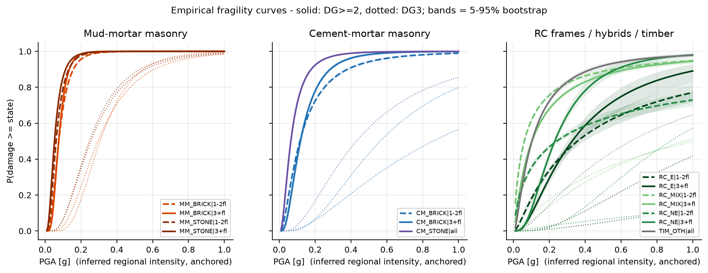
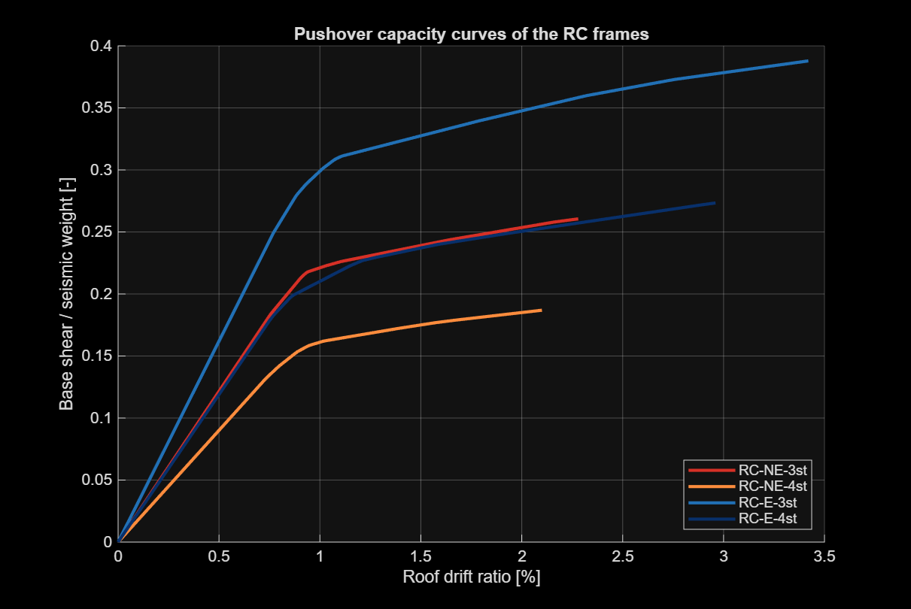
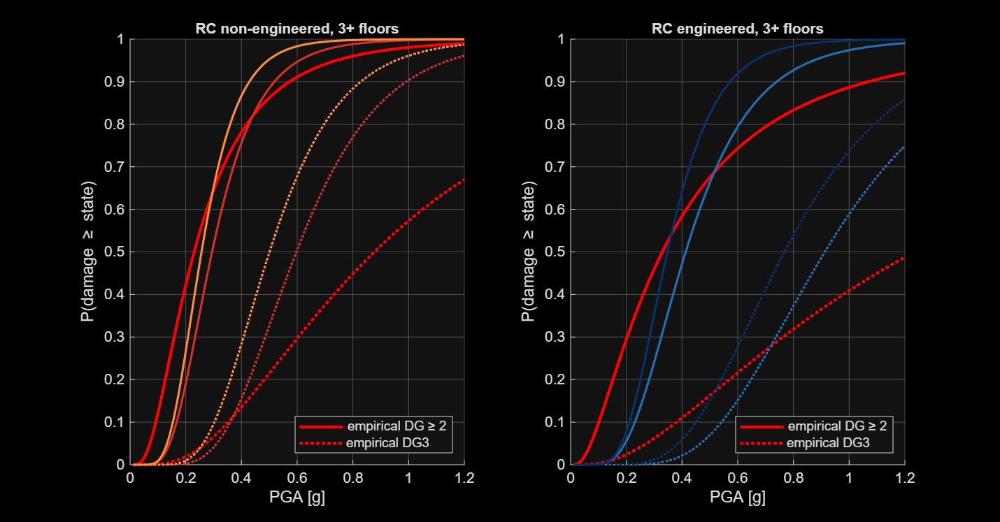

# Data-driven seismic fragility and recovery modelling for Nepal's building stock
Real 2015 Gorkha earthquake damage data -> empirical fragility curves -> machine-learning damage model -> MATLAB analytical fragility of RC frames -> validation -> Pokhara study-ward damage and recovery simulation -> baseline vs masonry-retrofit benefit-cost.

**Read `docs/limitations.md` first.** Several inputs are placeholders (marked ASSUMPTION in `config/params.yaml`), and the ShakeMap, real ground-motion records and an official ward boundary were not available when this project was generated.

## Quick start (VS Code)
```bash
python -m venv .venv && source .venv/bin/activate        # Windows: .venv\Scripts\activate
pip install -r requirements.txt
code .                                                   # accept the recommended extensions (Python, Jupyter, MATLAB)
python scripts/run_all.py                                # full pipeline (~8 min incl. ML; --skip-ml / --skip-matlab available)
```
Everything the pipeline produces is already in `results/` (figures and tables), so you can open the notebooks straight away.
MATLAB step: open `matlab/run_analytical_fragility.m` in VS Code/MATLAB and run, or `bash scripts/run_matlab.sh` (MATLAB, else Octave). No toolboxes needed.

## Pipeline
| Step | Tool | Script / module | Output |
|---|---|---|---|
| Extract OSM buildings | Python | `scripts/01_extract_osm.py` | `data/processed/osm_buildings.csv` |
| Clean + explore Gorkha data | pandas | `02_clean_explore.py`, `gfr/data_prep.py` | `results/tables/damage_by_class.csv`, fig 01 |
| Empirical fragility | scipy, statsmodels | `03_empirical_fragility.py`, `03b_anchor_sensitivity.py`, `gfr/fragility.py` | `empirical_fragility_params.csv`, figs 02-04 |
| Gradient boosting | scikit-learn | `04_ml_model.py`, `gfr/ml_model.py` | `ml_*.csv`, fig 05 |
| Analytical fragility | MATLAB / Octave | `matlab/run_analytical_fragility.m` | `results/matlab/*.csv` |
| Validation | Python | `06_validation.py` | `validation_*.csv`, fig 06 |
| Ward scenario + recovery | Python | `07_community_scenario.py`, `gfr/scenario.py`, `gfr/recovery.py` | `scenario_results.csv`, figs 07-08 |
| Benefit-cost | Python | `08_decision_support.py`, `gfr/decision.py` | `benefit_cost.csv`, fig 09 |
| MATLAB figures | MATLAB | `matlab/plot_analytical_results.m` | `results/matlab/figures/M1-M4*.png` |
| *Upgrade:* real ShakeMap PGA | Python | `fetch_external_data.py`, `09_...`, `10_...`, `11_...` | see `docs/upgrade_to_real_pga.md` |

Notebooks in `notebooks/` walk through each stage (notebook 01 was executed; the rest run on demand).

## Folder layout
```
config/params.yaml      every assumption in one place
data/raw/               Gorkha survey subset + Pokhara OSM extract
data/external/          (empty) ShakeMap / Overpass downloads go here
src/gfr/                Python package
scripts/                numbered pipeline scripts, fetch_external_data.py, run_all.py
matlab/                 section, frame, pushover, IDA code + shared ground-motion set
notebooks/  results/  docs/  .vscode/
```

## Headline results (details in `results/RESULTS.md`)
- Gradient boosting: 0.739 accuracy with location, 0.618 structure-only, 0.569 majority baseline. Location IDs (a shaking proxy) dominate the importance.
- Mud-mortar masonry is far more vulnerable than every other class (DG>=2 median about 0.05-0.08 g vs 0.23-0.33 g for 3+ floor pure RC under the 0.20 g anchor).
- MATLAB RC frames agree with empirical DG>=2 medians within about 20 %, but give DG3 medians 0.63-0.68x the empirical ones.
- Ward scenario (assumed mix): the retrofit lowers expected DG3 buildings at the 475-yr level from 720 to 524 (urban core) and from 1274 to 770 (masonry-heavy mix). With placeholder costs the BCR is 0.74-1.41 (urban core) and 0.79-1.51 (masonry-heavy) for 12-5 % discount rates; break-even retrofit cost is 15-28 % and 16-30 % of replacement cost.

## ShakeMap replay of the 2015 event (Pokhara tile)
USGS ShakeMap for event us20002926 (`python scripts/fetch_external_data.py`).
PGA sampled at the study-tile centre (lat 28.2214, lon 83.9867) with
`python scripts/09_shakemap_to_region_pga.py --centroids data/external/pokhara_point.csv --out data/external/pokhara_pga.csv`
gave 0.233 g, added as `gorkha_2015_replay` in `config/params.yaml`.
This is a single interpolated value from a modelled field, not a validation.

## Replace before you cite any number
Class mix / census data, unit costs, retrofit effectiveness, recovery parameters, NBC 105 Z for Pokhara, ShakeMap-based anchor, real accelerograms. See `docs/upgrade_to_real_pga.md`.

## References
- Bull, P., Slavitt, I., Lipstein, G. (2016). Harnessing the Power of the Crowd to Increase Capacity for Data Science in the Social Sector. arXiv:1606.07781. https://arxiv.org/abs/1606.07781
- DrivenData, *Richter's Predictor: Modeling Earthquake Damage* (competition and training data derived from the 2015 Nepal Earthquake Open Data Portal; credit the original collectors as stated on the competition page).